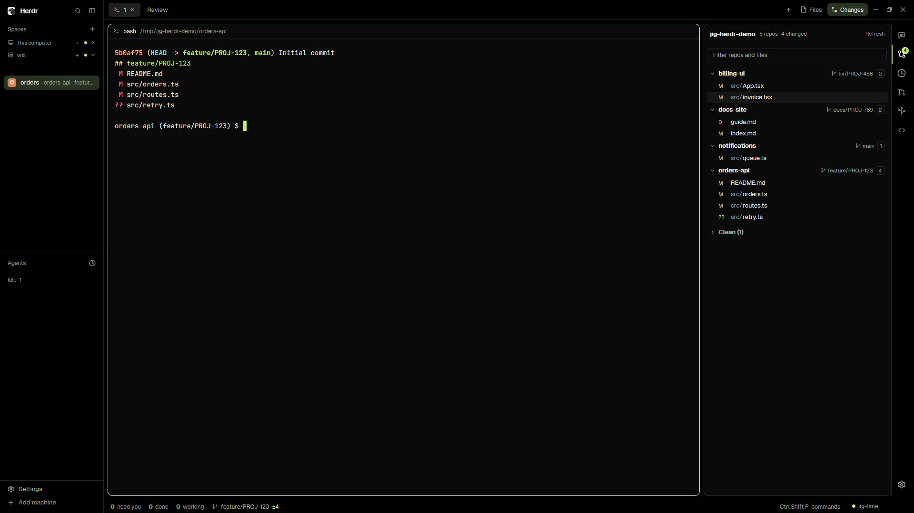

# The Herdr app: a layout and mods that work with Jig

**Status: built.** Tested with temporary folders (the install script, the layout, the mods' parsing and their scripts on real
repositories and status files). Seen working in the Herdr app 0.1.11 on Windows, with Pi in WSL as a Herdr machine. Not
tried: macOS, Linux, Triage's mods missing from a real Herdr folder.

This folder is not a Pi plugin: Pi never loads it. It is a set of files for the [Herdr](https://herdr.dev) desktop app, copied
into the app's folder by a script. They give Herdr a `jig` layout whose Jig button opens the **Work** panel for the Pi session
in focus, beside the changes of every git repository, a review tab and a colour theme that follows Pi's palette. The Work
panel reads the status files of the [`jig-session`](../plugins/jig-session/README.md) Pi plugin.



*The `jig` layout on a folder of five demo repositories, from before the Work panel. The Changes panel lists each one with
its branch and files. The status bar in the picture has since gone, and the palette is no longer named on screen.*

## What you see

| Where | What it shows |
|---|---|
| Tab bar | Tabs, `+`, then `Panel` (shows or hides the side panel) and `Jig` (shows it on the Work section) |
| Right panel, `Jig · Work` | The focused Pi session: ticket, workflow stages, pull requests, outputs, recent tool calls |
| Right panel, `Changes` | All repositories under the space's folder, changed ones first, with a filter |
| Right icon bar | One button per section, the Jig section at the top above a line; a count on `Changes` |
| A `Review` tab | One repository's changed files, and the diff of the chosen one, in strong red and green |
| A file tab | One file, read-only, opened from the Work panel's outputs |
| Nowhere, on purpose | The palette follower: a block of 0 px; the window takes the colours of Pi's palette, black when dark |

In **Work**, the ticket key and each pull request open in the browser, an output opens in a file tab, and the diff button on
an output with changes opens it in the `Review` tab. There is no status bar: Herdr's agents list on the left shows which
agents wait. `Ctrl+Shift+R` shows or hides the side panel, remembered for each space.

## Requirements

- **The Herdr app and herdr-core.** Mods are written for the app's mod runtime; see [Mods](docs/mods.md) for what each one
  calls.
- **`sh` and `git` on the machine that holds the folders.** `Changes` and `Work` run `sh` scripts there.
- **For the Work panel:** `jig-session` among the Pi plugins Pi loads, as every Jig plugin is.
- **For pull requests in Work:** `gh`, signed in by you, on the machine where Pi runs. Without it the panel says so.
- **For the `History`, `PR & CI`, `Worktrees` and `Settings` panels:** the [Triage](https://github.com/sgomez/herdr-triage)
  mods (EUPL-1.2), installed separately. Jig does not copy them. Without them the layout still works: the icon bar leaves
  their buttons out.

## Install

```bash
node herdr/scripts/install.ts            # into ~/.config/herdr-app
node herdr/scripts/install.ts /mnt/c/Users/<name>/.config/herdr-app   # the Windows app, from WSL
```

Then switch layout with `Ctrl+Shift+L`, or in Herdr's settings. The script
copies files, never links them, adds the keys to `keys.json` and leaves everything else of yours alone.
[Install](docs/install.md) says what it does on a second run, with `--force` and with `--dry-run`.

## Configure

Two files in the Herdr folder. Every field is optional, and later installs never replace them.

| File and field | Default | Meaning |
|---|---|---|
| `mods/jig-work/config.json` `machine` | the shown space's machine | Where Pi runs, as `hc machine ls` names it |
| `mods/jig-work/config.json` `stateDir` | `$JIG_STATE_DIR`, else `~/.local/state/jig` there | Jig's state folder where Pi runs: `~/…` or absolute |
| `mods/jig-work/config.json` `prOwners` | `[]`: pull requests that involve you | GitHub owners to search for the ticket's pull requests |
| `mods/jig-theme-sync/config.json` `machine` | `null`, this computer | The machine where Pi runs |
| `mods/jig-theme-sync/config.json` `agentDir` | `$PI_CODING_AGENT_DIR`, else `~/.pi/agent` | Pi's agent folder there |
| `mods/jig-theme-sync/config.json` `themeFolders` | `[]` | More folders to look for a palette in |

```json
{ "machine": "dev-box", "stateDir": "~/.local/state/jig", "prOwners": ["acme"] }
```

`jig-session` has no settings: it uses `$JIG_STATE_DIR` like jig-core, and `/session-file` in Pi says where its file is.
Colours, sizes and panels of the layout are changed as for any Herdr layout, in `layouts/jig.json`; [Mods](docs/mods.md)
lists the props each mod reads.

## How it fits with the plugins

- **`jig-session`:** the Work panel shows its status files ([the format](../plugins/jig-session/README.md#the-status-file)),
  matching a session to the focused terminal by `terminal` when `terminalFrom` is `HC_TERMINAL_ID`.
- **`jig-core`:** the Work panel's recent calls carry the decision jig-core published (`jig:decision`). The panel shows
  them; it never approves anything, and nothing in it can.
- **`jig-memory` and `jig-workflow`:** the ticket and the stages come through `jig-session`'s file.
- **`jig-theme`:** its six palettes are converted to Herdr themes (`themes/`), and a palette of your own is converted
  when it is in use. Changing the theme in Pi changes the window within five seconds.

## Rules

- **Read only.** The mods read status files and repositories; they write nothing on the machine where Pi runs.
- **The panels approve nothing.** Approvals happen in Pi, inside the waiting call.
- **Git without writes.** The mods run `git status` and `git diff` with options that write nothing under `.git`.
- **Copied, not linked.** The Windows app cannot follow a link made in WSL.
- **Yours stays yours.** The script replaces a file only if it wrote that file and you did not change it, unless `--force`.
- **Polled while shown.** Work reads the status files every 2 seconds and Changes the repositories every 5, only while on
  screen; pull requests are asked of `gh` at most every 5 minutes per ticket.

## Company part

None. Nothing here is specific to a company.

## Layout

```text
herdr/
  layouts/    jig.json and the picture the settings screen shows (copied, with mods/ and themes/)
  mods/       jig-work, jig-tabs, file-view, repo-changes, repo-review, jig-activity, jig-theme-sync
  themes/     one Herdr theme for each Jig palette, made by scripts/build-themes.ts
  keys.json   merged into the Herdr folder's keys.json
  RECIPE.md, preview.png   for sharing the layout
  scripts/    install.ts, build-themes.ts
  test/       the install script, the committed themes, the layout, the mods' parsing and scripts
  docs/       the detail pages below
```

## More detail

- [jig-session](../plugins/jig-session/README.md): the status file the Work panel reads
- [Install](docs/install.md): the script, a second run, `--force`, Windows with WSL, removing it
- [Mods](docs/mods.md): each mod, what it reads and calls, its props, and how the layout is put together
- [RECIPE](RECIPE.md): the brief another agent can build the layout from, in Herdr's format
