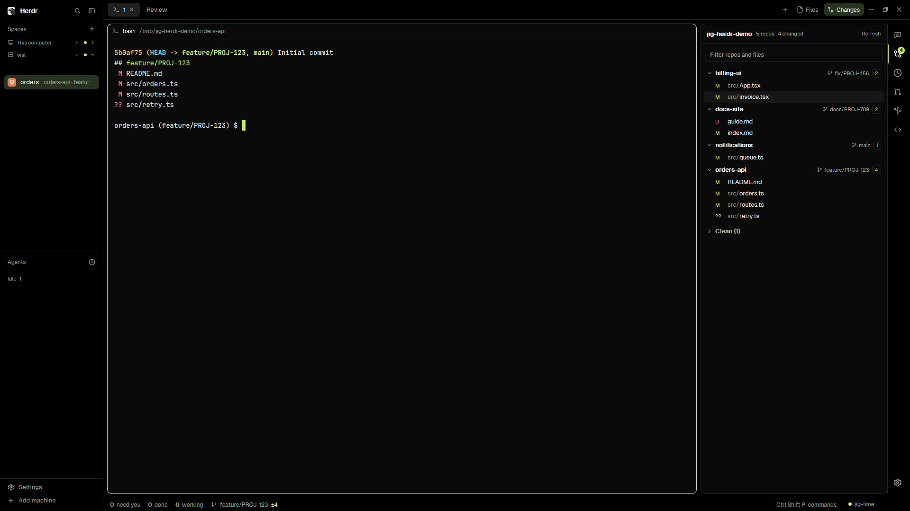

# Jig

A black window with lime highlights for working with coding agents on several git repositories at once. Herdr's spaces and
agents lists stand on the left, terminals are cards in the middle, and a side panel on the right shows, one at a time and
switched by a narrow icon bar: the Work panel of the Pi session in focus (its ticket, workflow stages, pull requests, the
files it changed and its recent tool calls), the Context panel of that session (what fills its context, and a switch for
each tool and skill), then Git, History, PR & CI, Worktrees and Files
for the repositories under the space's folder. There is no status bar: the agents list on the left shows their states. The
window follows, unseen, the colour palette the Jig plugins give Pi.

Each listed panel's full brief lives in `gallery/<id>/RECIPE.md`; this recipe adds only what the private `jig` layout and
its Jig-only panels contribute.

## What you see

Left to right, top to bottom, in a window with no system title bar (`titlebar: none`, `traffic_lights: [12, 16]`):

- **Sidebar, 300 px (44 to 520), background `chrome`,** not resizable. A 46 px brand row (`workspace-chrome`, drags the window), then
  Herdr's `spaces` and `agents` lists sharing the height equally (each at least 90 px), 0 px blocks for `jig-theme-sync`
  (it draws nothing), then a 69 px footer
  (`workspace-chrome` with `footer: true`).
- **Work column.** A 42 px tab bar (`jig-tabs`, drags the window): Herdr's tab pills and `+`, then two 26 px buttons with an
  icon and a label, `Panel` (`panel-right` icon) and `Jig` (a set-square icon), on `selected` while lit, and a 26 px sun
  (Keep awake) that takes the accent colour and a selected background while the computer is held awake. Below it, on 8 px
  padding with an 8 px gap: the terminals, and the side panel.
- **Terminals** as cards: radius 10, 8 px gap, 1 px `border`, a 1 px `accent` border on the focused one, and a 30 px header
  (`pane`) always shown. A single terminal is framed too (`lone: true`).
- **Side panel, 420 px (300 to 900),** a row of a stack and a bar. The stack shows one panel: Jig · Work, Git, History,
  PR & CI, Worktrees or Files. Work is the one shown first.
- **Icon bar, 40 px,** background `chrome`, a 1 px `border` on its left. One 18 px icon for each panel, 40 px square, with a
  2 px `accent` bar on the left of the active one and the `foreground` colour; the others are `dim`. The Jig icon and the
  Context gauge are first, with a 1 px `border` line under them. A round badge (15 px, `blocked` or `accent` colour, the count in the window's background colour, `99+` at most)
  sits at the top right of an icon that has a count.
- **Work panel.** On `chrome`. A header: `π` in `accent`, the folder's name, `·`, the model in `muted`, the thinking level,
  and at the right a 7 px dot and `working` (`working`) or `idle` (`idle`, `dim`); a second line in `dim` with `context N% of <window>`, the cost, the terminal and `N sessions ▾` when several run. Then sections with a 10.5 px semibold `dim` heading:
  `TICKET` (the key in `accent`, the title; the stages as 20 px pills joined by 1 px lines, done ones ticked with an `accent`
  border, the current one filled `accent` with `accent_foreground` text, later ones `dim`), `PULL REQUESTS` (a branch icon,
  `#N`, the title, `open`/`draft`/`merged`, the review state, `✗N` in `ansi1`, `●N` in `working`, `✓N` in `ansi2`; failing
  check names below in `ansi1`), `OUTPUTS` (`A` in `ansi2` or `M` in `blocked`, the name, the folder dimmed, a diff button,
  the time) and `RECENT` (time, tool and action, the decision, the outcome coloured). Rows are 22 to 26 px.
- **Context panel.** On `chrome`. The same header as Work with a `Reload` button at the right (outlined, 22 px). Then the live `<percent>% used · <used> / <window>` line (15 px semibold), a 10 px bar split by share of the window, and a legend of 22 px rows: a 10 px square,
  the part, the tokens (`≈` before counted ones) in `muted`, the percentage in `dim`. Colours: Messages `accent`, Tools
  `ansi6`, System prompt `foreground`, Skills `ansi5`, Context files `ansi3`, Compaction buffer `dim`, Free space `raised`.
  Under it the last answer (`✓` in `done`, `✗` in `blocked`), then folded sections `▸ TOOLS N of M on`, `▸ SKILLS N` and `▸
  CONTEXT FILES N`: 24 px rows with the name, the size and a 28×16 switch (`accent` when on, a 10 px knob).
- **Git panel.** A 42 px header with the folder's name (full path on hover), the `Terminal`/`Space` switch and Refresh;
  fold-all appears when there are several repo groups, fetch-all when a checkout has a remote. A muted body line under the
  header carries `N repos · M changed` (with the worktree count when there is room); a filter box; then a
  one line for each checkout with changes (its name, a branch chip with an icon, the parent folder only on a name clash, a `2 vs main` chip
  when the branch has commits its base lacks, `↑` ahead in `foreground`, `↓` behind in `blocked`, then pull and push/publish
  icons, and a count in a small outlined box), and under it its linked worktrees as `↳ <folder>` rows, indented 18 px,
  each the same way. Under each row, dim: the last commit's short hash, subject and age. Under that, the files: a 14 px
  checkbox (ticked on `accent` when staged, `–` when partly), a letter (`M` in `blocked`, `A` and `??` in `ansi2`, `D` and `U`
  in `ansi1`, `R` in `ansi5`) and the path with its folders dimmed; then, when some are staged, a `Commit message` box,
  `Commit N` and `Commit & Push`. Last, a `Clean (N)` group, folded.
- **Review tab.** A 280 px list of the repository's changed files on the left, and on the right a 32 px header (path,
  `+added`, `−removed`, `Stage` or `Unstage`, `Discard…`, `‹` `›`) over the diff: 20 px rows, a hunk header row on `surface` in `ansi6`, a 3 px bar at the left
  edge of each changed line, added lines tinted with `ansi2` at 16 % and removed lines with `ansi1` at 22 %.
- **Colours.** The theme `jig-lime`, from the palette: window `#0A0A0A`, bars `#000000`, text `#E4E8DD`, accent `#C4F36B`.
  Fonts and sizes are Herdr's.

## How it behaves

- **Agent states.** Herdr's agents list shows them: `blocked` in amber, `done` in lime, `working` in cyan. The Work panel's
  header says `working` or `idle` for the Pi session it shows.
- **Keys.** `Ctrl+Shift+R` toggles the side panel (`layout.toggle:panel`).
- **Work.** A 1 s tick notices focus, session and window changes; while the followed session works, a 3 s check reads
  only the status files whose mtime moved, and the `refreshSeconds` backstop (default 60 s) does a full read. The read is
  one `sh` on the machine where Pi runs, checking that each Pi still runs. The session shown is the focused terminal's, else the one picked in
  the list, else the one updated last. A click on the ticket key or a pull request opens the browser; on an output, a file
  tab (`jig-file-view`, selected again if open); on its diff button, the `Review` tab. Pull requests are read with `gh` at most
  every 5 minutes per ticket; `Refresh` reads them now. Nothing in the panel approves or changes anything.
- **Context.** Uses the same 1 s tick, 3 s changed-file check and `refreshSeconds` backstop as Work, with Work's script. A switch or `Reload` writes the session's request file
  through a temporary file and a rename, carrying every switch not answered yet, and shows dimmed until the session's
  answer comes. A tool switch applies from the model's next request and a skill switch from the next prompt; Reload waits until the agent is idle.
- **Panel and Jig.** `Panel` shows or hides the side panel on its last section; `Jig` shows the Work section, and hides the
  panel when it already shows it. The panel's state is remembered per space.
- **Keep awake.** The sun holds the computer awake on its idle timer: Off, On (until switched off or Herdr closes), or While
  agents work (while any agent anywhere is working or blocked, and `idleMinutes` after the last one). A click turns Off ↔
  On; a right click opens a 330×252 popup with the three modes, a `Keep screen on` switch (on by default; writing it restarts
  the helper at once), whether the request is held and that a lid or the power button still sleeps the computer.
  `Ctrl+Shift+Alt+K` cycles the modes. The helper is a hidden PowerShell (`SetThreadExecutionState`) on Windows,
  `caffeinate -i [-d] -w <herdr pid>` on macOS, or `systemd-inhibit --what=sleep[:idle] --mode=block sh -c 'while kill -0
  <herdr pid> ...' jig-keep-awake` on Linux, started on Herdr's own computer and stopped when it is no longer wanted or Herdr
  exits; its request ends with its process.
- **Git.** It follows the focused terminal's folder (its checkout and linked worktrees, else the repositories below it),
  or the space's folder when the header's toggle says `Space`; the choice is kept per space in `localStorage`, and a switch
  keeps the old rows until the new ones arrive and never clears the filter. One `sh` script on the space's machine reads
  them: when the panel is shown, when it is opened, when a terminal changes status or the folder changes, after an action,
  and at its 60-second backstop. A click on a repository's row folds it; the filter keeps repositories whose name matches
  (with all their files) or whose files match. Hovering a row shows `+` (stage all), `−` (unstage all), the fetch icon and a
  terminal button; hovering a file shows `↺`, which asks inline before discarding (`DELETED` for a new file). A checkbox
  stages or unstages its file; the message box commits the staged files, `Commit & Push` then asks before pushing. Fetch
  and pull run at once; push and publish open a 440 px dialog first with the branch, the destination git will really
  use and up to ten commits, and nothing is sent until its button is pressed. The destination comes from git's own settings
  (`pushRemote`, `remote.pushDefault`, `push.default`) and the push names it in full; a branch whose push target is another
  branch is published under its own name instead, never pushed onto that branch. Network commands run with
  `GIT_TERMINAL_PROMPT=0` and, where the machine and the repository set none, `GIT_SSH_COMMAND="ssh -o BatchMode=yes"`,
  under a 60-second `timeout` or a `sleep`/`kill` watchdog. One action at a time per checkout, shared by the panel and its
  dialog. A click on the branch chip opens a 360×440 popup: a search box; before typing it shows local branches only, with `Type to
  search N more on origin` when origin has more; typing ranks exact, prefix, last-segment and substring matches, locals
  first. The current branch is ticked, one in another worktree is greyed `in use by <folder>`, and the row Enter would
  choose has a 2 px `accent` left edge. `New branch…` prefills its name box from `config.json`. A
  switch is refused while an agent works in the checkout or files are uncommitted; a pull, push or publish, while an
  agent works there or on a detached HEAD; a push, when git's destination for the branch is a different branch or there is
  none. A click on a file opens or retargets the tab `Review · <repository>`.
- **History.** On a folder with several repositories, a repository chooser row comes first (inside one repository there is
  none). Then a 42 px header with the branch title, the `Terminal`/`Space` switch and Refresh; a second 24 px row holds
  `Branch`/`All`; a filter box; then the commit graph: 24 px rows with
  lanes 14 px apart, a dot per commit (a ring for the checked-out one), the author's initials, branch and tag pills, the
  pull request number, the conventional-commit type, the subject and the age. A click opens the message and files under the
  row; a file or `Open diff` opens `git show` in a terminal beside. The branch title opens the picker; local branches come
  first, and the row Enter would choose has an accent edge. `Branch` or `All` chooses the scope; `Load more` adds 100.
- **PR & CI.** The `Workspace` tab: each repository on a feature branch with its pull request, its checks (`×` failed, `•`
  pending, `✓` passed, `–` skipped; a cancelled run is skipped) and review state. Repositories without a PR fold into
  `No PR (N)`; default-branch repositories fold into `On default branch (N)`. The `Mine` tab: your open pull requests by repository. A click opens the pull request or check in the browser.
- **Worktrees.** A 42 px header titled with the count (`15 worktrees`, `1 worktree`, or `Worktrees` before a read; the
  full repo · count is the tooltip), the `Terminal`/`Space` switch, `Prune merged (N)` and Refresh. Linked worktrees of every
  repository, grouped, newest first, each `Ready to remove` or `In progress`. Ready
  needs: nobody working there, not locked, no uncommitted change, **no commit on no remote (unpushed commits are never ready)**,
  and the work in the base or the remote branch deleted. `Remove` asks twice and runs `git worktree remove` (no `--force`)
  and `git branch -d` (never `-D`).
- **Files.** A tree of the folder, lazily read; folders open in place, a letter marks files with changes, a click opens the
  file in a `jig-file-view` tab (a second click selects it).
- **Review.** Arrow keys and `j` and `k` move between files; `‹` `›` too. The list is read again every 5 seconds while the
  tab is on screen; an unchanged diff keeps its scroll position.
- **Theme follower.** Every 5 seconds it reads Pi's `theme` setting, makes a Herdr theme from that palette and switches to
  it. Nothing shows it: a problem comes as a notification. Dark palettes keep the black window.
- **Badges.** `jig-git` sets `shared("badge.jig-git")` to the number of checkouts with changes. The icon bar
  shows a badge for `shared("badge.<mod>")` on the button of that mod.

## Built from

The layout is `layouts/jig.json`, rewritten from Herdr's shipped `main` layout. Nodes, by `id`:

- `root` (row; theme `jig-lime`, `background: canvas`, `terminal_padding: [14, 12]`, 1 px `border` dividers, `preview:
  layouts/jig.svg`)
  - `sidebar` (column, 300 px, min 44, max 520) with `brand`, `sidebar-lists` (`spaces`, `agents`), `jig-theme` (0 px,
    mod `jig-theme-sync`), `jig-keep-awake` (a 0 px block, mod `jig-keep-awake`) and `sidebar-footer`
  - `work` (column) with `tabs` (mod `jig-tabs`) and `work-body`
    - `work-body` (row, padding 8, gap 8): `main` (`{ tab: "active", pane: {...} }`) and `panel` (row, 420 px)
    - `panel`: `panel-body` (stack, active `jig-work`) and `activity` (block, 40 px, not resizable;
      mod `jig-activity`, props `{ stack: "panel-body" }`)

Each child of `panel-body` is a block with a `title` and a mod, and its `content.props.activity` holds `{ icon, end? }`:

| id            | title         | mod             | icon                                                             |
| ------------- | ------------- | --------------- | ---------------------------------------------------------------- |
| `jig-work`    | Jig · Work    | `jig-work`      | `mods/jig-activity/icons/jig.svg`                                |
| `jig-context` | Jig · Context | `jig-context`   | `mods/jig-activity/icons/context.svg` (a gauge), `divider: true` |
| `changes`     | Git           | `jig-git`       | `mods/workspace-chrome/git-compare.svg`                          |
| `history`     | History       | `jig-history`   | `mods/workspace-chrome/clock.svg`                                |
| `pr`          | PR & CI       | `jig-prs`       | `mods/jig-activity/icons/pr.svg`                                 |
| `worktrees`   | Worktrees     | `jig-worktrees` | `mods/jig-activity/icons/worktree.svg`                           |
| `files`       | Files         | `jig-files`     | `mods/workspace-chrome/files.svg`                                |

The mods, all in `mods/`, each with `mod.json` `{ "place": "none", "title": "..." }`:

- **`jig-work`** (props: none; settings in `config.json`: `{ machine, stateDir, prOwners }`). `exec("sh", ["-c", SCRIPT, "sh", stateDir],
  { on })` for the status files, `exec("sh", ...)` for git on the outputs, `exec("gh", ...)` for pull requests, `exec` of the
  browser opener here, `focused()`, `spaces()`, `panes()`, `layout()`, `run("tab.new" | "tab.select")`, `setShared` of
  `jig-file-view.tabs` and `jig-review.open`, `notify`. Files: `main.js`, `lib.js` (the scripts, the parsing, which session).
- **`jig-context`** (props: none; reads `mods/jig-work/config.json` for `machine` and `stateDir`). The same `exec("sh",
  ["-c", SCRIPT, "sh", stateDir], { on })`, and for a switch or Reload one `exec("sh", ["-c", 'printf %s "$2" > "$1.tmp" &&
  mv "$1.tmp" "$1"', "sh", requestFile, json], { on })`; `focused()`, `spaces()`, `layout()`, `localStorage` for the open
  lists. Files: `main.js`, `lib.js` (a copy of Work's session finding, the bar, the request).
- **`jig-tabs`** (props `{ panel, stack, jig }`). Herdr's `tabs` mod (Apache-2.0) with the two buttons and the sun;
  `run("layout.select" | "layout.show" | "layout.hide")`, `setShared("jig-keep-awake.mode", ...)` from the sun, and
  `openOverlay({ mod: "jig-keep-awake", kind: "popup", props: { menu: true } })` on a right click; icons
  `mods/jig-tabs/jig.svg`, `mods/jig-keep-awake/jig-keep-awake.svg`, `mods/workspace-chrome/panel-right.svg`, and Herdr's window
  buttons from `mods/tabs/`.
- **`jig-keep-awake`** (props: none, or `{ menu: true }` for its popup; settings in `config.json`: `{ idleMinutes, display }`).
  Reads `agents()`, `window()`, `shared("jig-keep-awake.mode")`; sets `shared("jig-keep-awake.mode" | "active" | "helper")`; runs
  `exec` on Herdr's own computer for the helper (`powershell`'s `Start-Process -WindowStyle Hidden`, `sh` for `caffeinate`
  or `systemd-inhibit`), for `appPidCommand`, `aliveCommand`, `commandLineCommand` and `stopCommand`; reads and writes
  `jig-keep-awake.stop` in the app folder with `readTextFile`/`writeTextFile`; `notify` on a failure. A 1-second timer decides,
  a 10-second check asks whether the helper is still ours, and a `nextCommand()` loop serves `cycle`, `on`, `off` and
  `agents`. Files: `main.js`, `lib.js`, `jig-keep-awake.ps1`, `jig-keep-awake.svg`, `config.json`.
- **`jig-file-view`** (props `{ on, path }` from `tab.new`). `readTextFile(path, { on })`, `EditorState` and `Editor` from
  `gpui-base`, read-only.
- **`jig-git`** (props: none; `{ picker }` for its branch popup, `{ push }` for its push dialog; settings in
  `config.json`: `{ newBranchPrefix, baseBranch, remote, networkTimeoutSeconds, rowDetail, refreshSeconds }`). Reads `spaces()`, `panes()`,
  `focused()`, `terminals()`, `layout()`, `appHome()`, `shared("jig-git.running")`; reads its `config.json` with
  `readTextFile`; runs `exec("sh", ["-c", SCRIPT, "sh", root], { on })` with the space's machine, `exec("git", ..., { cwd,
  on })` for the actions, and the network ones through one `sh -c` that sets the environment and a `timeout` (or a
  watchdog); `openOverlay` for the picker (`kind: "popup"`) and the push dialog (`kind: "dialog"`, 440 wide); `run("tab.new", ...)` for the Review tab and terminals; `setShared` for the
  badge and `jig-git.done`. `InputState` and `Input` for the filter, the commit messages (made in the timer, never in
  `render`) and the picker. Icons: its own `fetch`, `pull`, `push`, `refresh`, and `mods/workspace-chrome/`
  `branch`, `check`, `chevron-down`, `chevron-right`, `folder`, `minus`, `plus`, `terminal`. Files: `main.js` (the panel),
  `picker.js`, `push.js` (the confirm dialog), `lib.js` (the script, the parsing, the grouping and the git actions, each
  taking `exec` and returning `{ ok, message }`), `layout.js`, `refresh.js`, `panel-header.js`, `follow.js`,
  `follow-state.js`, the SVG icons and `config.json`.
- **`jig-review`** (props `{ on, repo, name, file? }` from `tab.new`; read them with `props()`). `exec("git", ...)` and
  `readTextFile` with `{ on }`; `v_virtual_list` and `Scrollbar` from `gpui-base`. Its `lib.js` copies the stage, unstage
  and discard functions of `jig-git`. Files: `main.js`, `lib.js`, `refresh.js`, `panel-header.js`.
- **`jig-history`** (props: none). `exec("sh", ["-c", SCRIPT, "sh", root], { on })` for the repositories, `exec("git", ...,
  { cwd, on })` for `log`, `status` and `show`, `run("terminal.open", ...)` for a diff. `InputState` and `Input` from
  `gpui-base` for the filter and the picker. Files: `main.js`, `lib.js`, `refresh.js`, `panel-header.js`, `follow.js`,
  `follow-state.js`.
- **`jig-prs`** (props: none). `exec("sh", ...)` for the repositories, `exec("gh", ...)` for `pr view`, `pr list` and `search
  prs` (four at a time, cached 5 minutes in `localStorage`), `exec` of the browser opener here, `setShared` for the badge.
  Files: `main.js`, `lib.js`, `refresh.js`, `panel-header.js`, `follow.js`, `follow-state.js`.
- **`jig-worktrees`** (props: none). `exec("sh", ...)` for the worktrees, `spaces()`, `panes()` for who is at a checkout,
  `run("space.select" | "tab.new")`, and for Remove only `exec("git", ["worktree", "remove", path])` and `exec("git",
  ["branch", "-d", branch])`. `setShared` for the badge. Files: `main.js`, `lib.js`, `refresh.js`, `panel-header.js`,
  `follow.js`, `follow-state.js`.
- **`jig-files`** (props: none). Herdr's `files` mod (Apache-2.0, header kept) with `run("tab.new", { mod: "jig-file-view" })`
  instead of an in-panel preview; icons from `mods/workspace-chrome/`. Files: `main.js`, `lib.js`, `refresh.js`,
  `config.json`.
- **`jig-activity`** (props `{ stack }`; a child's `activity` may have `divider: true`). `layout()`, `shared()`, `readTextFile` of `mods/<mod>/mod.json` to see which mods exist,
  `run("layout.select", { stack, child })`. Icons in `mods/jig-activity/icons/`: 24 px viewBox, stroke `currentColor`, 1.5.
- **`jig-theme-sync`** (props: none; settings in `config.json`: `{ machine, agentDir, themeFolders }`). `exec("sh", ...)`
  once for `$HOME` and `$PI_CODING_AGENT_DIR`, `readTextFile(..., { on })`, `writeTextFile` into `themes/`,
  `run("app.theme")`, `notify`. `convert.js` has `toHerdr(vars, appearance)`. Its `render` returns an empty `div()`.

`themes/jig-*.json` are the six palettes of `jig-theme` as Herdr themes: dark ones with `background #0A0A0A`, `canvas` and
`chrome` `#000000`, `surface` and `popover` `#111111`, `border` `#262626`; the terminal colours and `accent`, `selected`,
`working`, `blocked`, `done`, `idle` from the palette. `keys.json` adds the section `layout:jig` with the three keys above.

The layout uses four mods that are not here, the ones Herdr ships: `workspace-chrome`, `spaces`, `agents` and `pane`. The
Work panel needs Jig's Pi plugin `jig-session` loaded in Pi: it writes the status files.

## Watch out

- **Write `mod.json` before `main.js`** for every new mod folder, with `"place": "none"`. Herdr docks a folder it has never
  seen where its `mod.json` says (or a default place without one), which puts a stray copy into the shown layout.
- **A layout node keeps only the fields Herdr knows.** An `icon` or `end` on a stack child is dropped by `layout()`; they live in
  `content.props.activity`, which is kept whole.
- **Never call `cx.notify()` from `render`.** Both polling mods check what changed in a one-second timer and start their work
  from there.
- **Every `exec` and `readTextFile` on project files needs `{ on: machine }`.** Without it the call runs on this computer.
  Tab mods get their props from `props()`; `init`'s argument is empty.
- **Herdr watches folders only on this computer,** so spaces on another machine are polled.
- **A new space may start with the side panel hidden;** it is remembered for each space. Show it with the tab bar's
  `Panel` or `Jig` button, or `Ctrl+Shift+R`.
- **A terminal's address has its machine in front** in the app (`dev-box/t7`), but herdr-core sets only `t7` in the terminal
  (`HC_TERMINAL_ID`). Put the machine in front before comparing with `focused().terminal`.
- **`tab.new` does not give a mod the new tab's id.** Find it as the tab that was not there before, and keep the map in
  `shared("jig-file-view.tabs")` so a second click selects it.
- **A block of 0 px still runs its mod.** Its timers run, so `jig-theme-sync` syncs and `jig-keep-awake` watches agents without
  taking a line of the sidebar.
- **Pane headers stay `"reveal": "always"`.** On hover the header is drawn over the terminal and hides its prompt line.
- **Poll only while shown.** A mod's timers run while its block is hidden; check `layout()` (no hidden node, every stack on
  the way showing it) before reading.
- **A block whose mod is missing** shows `<mod> did not load` and adds an error to `herdr-app status`; the rest still works.
  `jig-activity` leaves out that panel's button.
- **Mods cannot import each other,** so `lib.js` of `jig-review` is a cut-down copy of `jig-git`'s, `jig-context` copies
  `jig-work`'s session finding, and every panel
  has its own check that its block is on screen.
- **Every git write is a click, with git's own safety.** No `--force`, `-D`, `reset`, `--amend`, `--no-verify` or push;
  file names go with `--literal-pathspecs`; a discard and a branch switch read the checkout again right before.
- **No sign-in.** The mods run `git`, `sh` and `gh` and read files; the one fetch is `git fetch origin <base>` for a new
  branch. `gh` is signed in by you, or the Work
  panel says it is not.

## Done when

- `herdr-app check mods/<name>` passes for each of the twelve mods, and `herdr-app status` shows no `errors` after
  `layout.switch {"name":"jig"}`.
- The sidebar shows Herdr's spaces and agents lists, the terminals are cards, and the right panel shows the icon bar with the
  Git icon active and a badge equal to the number of checkouts with changes.
- With a space whose folder holds several git repositories, the Git panel lists all of them, changed ones first, with
  branch and counts; editing a file in one shows it within 5 seconds. A terminal `cd`ed into one repository lists that one
  (the header's toggle back to `Space` lists the space's folder again), and a branch one commit ahead of its upstream shows
  `↑1`; the push icon opens the confirm with that commit and the destination it names, and Cancel sends nothing. With
  `branch.<b>.pushRemote` set to another remote, the dialog names that remote's branch and the push goes there only.
- A linked worktree shows as a `↳` row under its repository. Ticking a file's checkbox stages it within a second, the
  commit box commits it and says the short hash, and the branch chip's popup switches branch; with a file changed, the
  switch is refused and says how many files.
- Clicking a changed file opens a `Review · <repository>` tab with the file's diff, red and lime tinted rows; clicking another
  file of the same repository changes that tab instead of opening a second one.
- The History, PR & CI, Worktrees and Files icons each open their panel: History shows the commit graph of the chosen
  repository, PR & CI lists the pull requests of repositories on a feature branch, Worktrees marks a clean, merged worktree
  `Ready to remove` (and a worktree with an unpushed commit `In progress`), and Files opens a file in a tab.
- Setting `theme` to `jig-signal` in Pi's `settings.json` makes the window take the cyan palette within 5 seconds.
- `Ctrl+Shift+R` hides and shows the side panel, and switching to another layout and back keeps everything working.
- With Pi and the Jig plugins running in a terminal of the window, `/ticket PROJ-123` and a file written by the agent: the
  `Jig` button shows that session's ticket, its stages, the file under `OUTPUTS` and the `write` call under `RECENT`,
  within a few seconds; a click on the file opens it in a tab.
