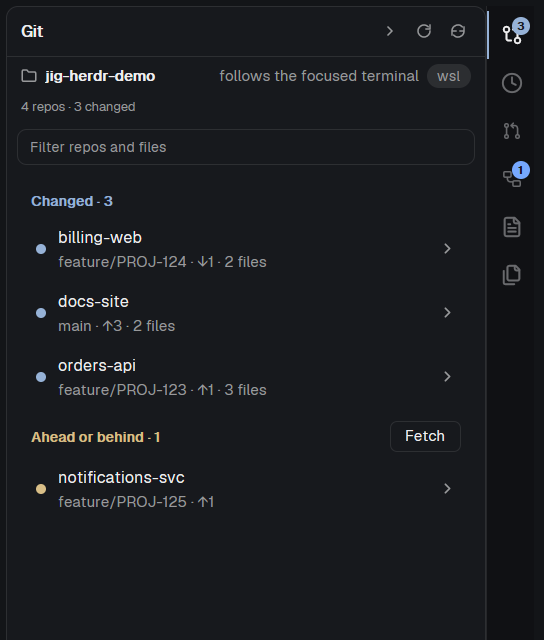

# Git

Git for every main checkout in the focused folder: stage, commit, fetch, pull and push, switch branches, and open a file's diff in Review. Read-only until you use one of its buttons. From Jig (https://github.com/ClawdBuilder/jig). No Jig required.

**Install:** add the listing from herdr.dev, or copy the repository's `mods/jig-git` into your Herdr config folder's `mods/`. Put a layout block with `content.mod = "jig-git"` where the panel should sit.

**What you see:**

A 42 px header titled **Git**, with fold-all (when more than one group is visible), fetch-all (when a checkout has a remote) and Refresh. A 32 px context card under it names the folder, shows **follows the focused terminal** or **uses the space's folder**, and carries the machine pill. A muted line under the card counts repos and changed files; while a new folder, terminal or follow mode is read, the list is a four-row skeleton.

The list is grouped **Needs you** (`ansi1`), **Changed** (`accent`), **Ahead or behind** (`ansi3`) and **Clean** (`muted`), each with a count and its batch action. Clean folds only when another group is visible; a lone group stays open. Each row is 48 px: a status dot in the group colour, the repo name, and a detail line such as `feature/PROJ-123 · ↑1 ↓2 · 3 files`, `not published`, `no upstream` or `detached`. Two same-named repos show their shortest parent (`apps/orders-web`, `old/orders-web`).

Opening a row puts it on `raised` with 24 px file rows (status letter, checkbox, path), then the commit box, then **Commit** (primary), **Push**/`Sync` (secondary, with the push confirm), **Branch**, and **Discard all…** (danger, inline confirm). A file row opens Review on click; its ↺ button discards that file after an inline confirm. The 40 px footer repeats the focused repo's branch, ahead/behind and uncommitted count; a transient status line sits above it. `↑`/`↓` move the active row, Enter/Space opens it, Esc closes rows.

The branch picker is an overlay with a search field. Before typing it lists local branches, plus `Type to search N more on origin`; typing ranks exact, prefix, last-segment and substring matches, locals first. The row Enter would pick has a 2 px `accent` left edge. Empty, no-git, detached-HEAD, busy and problem states each show one short line.

**How it behaves:**

A checkbox stages or unstages one file; the Changed group's **Stage all** appears when exactly one repo is shown. Discard asks inline first and never silently drops a staged-only file. **Commit & Push** commits, then opens the push confirm. `Ctrl+Enter` in the message box commits. **Fetch** and **Pull** run at once; **Push**/Publish ask first with the remote and branch. A diverged branch says so; pull fast-forwards only. Only one action per checkout runs at a time. A same-key refresh keeps the last-good rows; a key change (terminal, folder, follow mode, space) drops them and starts a new read. A stale read is discarded. Refresh on mount, when shown, on focus, when a terminal in the folder finishes, and on the backstop (`refreshSeconds`, default 60). Click-started runs show busy after 400 ms; automatic runs do not.

**Built from:**

`main.js` + `lib.js` + `panel-kit.js` + `panel-header.js` + `picker.js` + `push.js` + `refresh.js` + `follow.js` + `layout.js`; props `{ picker: true }` and `{ push: true }` render those overlays. Herdr: `focused`, `panes`, `spaces`, `exec`, `run`, `appHome`, `readTextFile`, `settings`, `shared`/`setShared`, `openOverlay`, `theme`, `layout`, `window`. Shared keys: `badge.jig-git`, `jig-git.folded`, `jig-git.running`, `jig-git.done`. Config: `${appHome()}/mods/jig-git/config.json` with `newBranchPrefix`, `baseBranch`, `remote`, `networkTimeoutSeconds`, `rowDetail` (`compact`/`full`), `refreshSeconds`; a bad field is reported, not fatal.

Programs: `sh` (one script reads all checkouts without writing), `git`, and `timeout`/`gtimeout` when present. Network: `git fetch`, `pull`, `push` only on those clicks. Files read: the folder's git metadata and working tree, and its `config.json`; writes: stage/unstage/discard, commit, fetch, pull and push. It opens `jig-review` with `tab.new` and sets `jig-review.open`, so the standalone listing bundles Review. Icons come from Herdr's `mods/workspace-chrome/*.svg` and this mod's own SVGs.

The shared header is 42 px: title and Refresh, whose tooltip says `Refresh · read N ago` (`Refresh` before the first read, `Reading…` while busy). The context card is 32 px. An error line sits under the card, above the kept rows.

**Header:** all git panels use one 42 px shared header: title and Refresh, whose tooltip says `Refresh · read N ago`
(`Refresh` before the first read, `Reading…` while busy). Git, History, PR & CI, Worktrees and Review's side panel put
the Terminal/Space switch in a 32 px context card under the header; a Review tab has title and Refresh only. An error
line sits under the header, above the kept rows.

**Watch out:**

Requires `git` on PATH, a POSIX `sh`, and an `origin` (or configured remote); Windows-local without WSL has no `sh`. The folder walk covers three levels and skips `node_modules`. Discard is permanent and has no undo. Network commands longer than 30 s need Herdr 0.1.14+; `networkTimeoutSeconds` defaults to 60. It never creates a worktree, merges, approves, force-pushes or uses `branch -D`. The standalone listing has `"place": "none"`, so a layout block is required. File and branch clicks need `jig-review`; this listing bundles it.

**Done when:**

`herdr-app check mods/jig-git` passes; a demo repo with one modified file shows it; stage/unstage, a `Ctrl+Enter` commit, Fetch/Pull/Push confirmation, the branch picker, a discard confirm and a no-git folder render; switching terminals shows the skeleton then the new rows within ~2 s; a `timeout`-less PATH still works.
