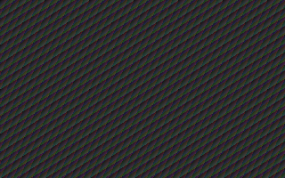

# History

The commit graph of a repository, or a repository chooser for a folder, with commit details and an **Open diff** terminal. Read-only: it never fetches or writes. From Jig (https://github.com/ClawdBuilder/jig). No Jig required.

**Install:** add the listing from herdr.dev, or copy the repository's `mods/jig-history` into your Herdr config folder's `mods/`. Put a layout block with `content.mod = "jig-history"` where the panel should sit.

**What you see:**

A 42 px header titled **History** with Refresh, the same 42 px shared header as the other panels. A 32 px context card under it names the folder, shows **follows the focused terminal** or **uses the space's folder**, and carries the machine pill. On a folder of several repositories a 26 px chooser row sits under the card and reads `billing-web · feature/PROJ-124`; a folder that is one repository has no chooser. A full-width segmented control reads **Branch n** and **All n**.

The graph lists 24 px commit rows with a coloured lane gutter, short hash, subject, author and age; a conventional type word (`feat`, `fix`, `docs`, `refactor`, `perf`, `test`, `build`, `ci`, `revert`) gets a hue. Clicking a commit puts a detail card on `raised`: full hash and **copy**, parents, author, date, subject, body, and the changed files with `+`/`−` counts. **Open diff** opens `git show` in a terminal to the right. The panel is read-only; there is no Review link on a commit's file rows.

Empty, no-git, detached-HEAD and unborn-branch states each show one line. While a new folder or follow mode is read, the graph is a four-row skeleton.

**How it behaves:**

Click a commit to open or close its card; the first open runs one `git show --numstat` read. **Open diff** places a terminal beside the panel showing that commit. The scope switch rereads with `--branches --remotes --tags HEAD` for **All**. The repository chooser searches under the focused folder and remembers the choice in `jig-history.branch`. Refresh on mount, when shown, on focus, when a terminal in the folder finishes, and on the backstop (default 60 s). A user-clicked read shows busy after 400 ms; automatic reads do not. A same-key refresh keeps rows; a context change is a skeleton until the read lands; a stale read is discarded. **Load more** reads the next page; the graph says when it is cut.

**Built from:**

`main.js` + `lib.js` + `panel-kit.js` + `panel-header.js` + `refresh.js` + `follow.js`; no props. Herdr: `focused`, `panes`, `spaces`, `exec`, `run`, `appHome`, `readTextFile`, `settings`, `shared`/`setShared`, `openOverlay`, `theme`, `layout`. Shared key `jig-history.branch`. Config `${appHome()}/mods/jig-history/config.json` (refresh settings); a bad field is reported.

Programs: `git log`, `git show`, `git status` on the space's machine; `sh` for the scan; `timeout`/`gtimeout` when present (20 s). Network: none; History never fetches. Files read: the chosen repository's `.git` metadata, its working tree for status, and its config. Nothing is written.

The header's branch control opens **Find a branch**. Before typing it lists local branches, with `Type to search N more on origin`; typing ranks exact, prefix, last-segment and substring matches, locals first, and `↑`/`↓` + Enter select one. The shared header is 42 px: title and Refresh, tooltip `Refresh · read N ago`.

**Watch out:**

Requires `git` and a POSIX `sh`; Windows-local without WSL is unsupported. Reads use a 20 s timeout. A very large history is paged, not all loaded; the lane gutter is a compact indication, not a full graph engine. Detached HEAD and unborn branches get a plain notice. No writes, no fetch, no network. The standalone listing has `"place": "none"`, so a layout block is required.

**Done when:**

`herdr-app check mods/jig-history` passes; a demo repo with two branches shows the lane gutter and commit cards; the scope switch changes the rows; a multi-repo folder shows the chooser with repo and branch; **Open diff** opens a right terminal; **Load more** appends; no-git and empty folders show their line; switching terminals shows the skeleton then the new graph within ~2 s.
