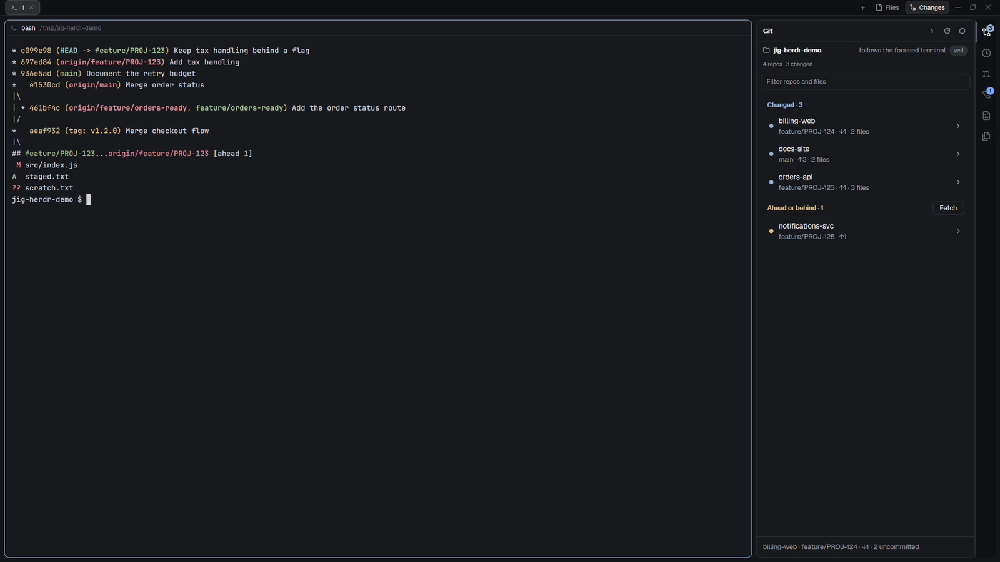

# Jig Workbench

A Herdr window with a 300 px sidebar for spaces and agents, a 40 px activity bar, and a right panel that switches between
Git, History, PR & CI, Worktrees, Review and Files, beside Herdr's normal tab bar and terminal. It is the generic Jig
layout: no Jig session is needed. From Jig (https://github.com/ClawdBuilder/jig). No Jig required.

**Install:** add the layout from herdr.dev, or copy `layouts/jig-workbench.json` and the six panel mods from this repository into your Herdr config folder. It needs `git` on the space's machine, a POSIX `sh`, and a signed-in `gh` for PR & CI; a Windows-local space without WSL has no `sh`. No Jig session is needed.

**What you see:**

The window has `titlebar: none`, traffic lights at `[12, 16]`, and `terminal_padding: [14, 12]`. It is a row: a 300 px
sidebar (minimum 44, maximum 520, not resizable), the work column, and inside the work column a 30 px tab bar, an 8 px
padded row with the terminal and a 420 px panel (minimum 300, maximum 900). The 40 px activity bar is **inside** that 420 px
panel, on its right. The sidebar has a 46 px brand block, spaces and agents as equal halves (minimum 90 px
each), a zero-height keep-awake block, and a 69 px footer. The 1 px dividers use the theme's `border` token; the layout uses
Herdr's default theme and its `canvas`, `chrome`, `background`, `border`, `accent` tokens (no colour is hard-coded in the
layout). The main pane has an 8 px gap, 10 px corner radius, a 30 px header, a 1 px border, and the focus border in
`accent`. The tab bar is Herdr's shipped `tabs` at 30 px, not `jig-tabs`: the Jig button would be dead without Jig's Work and
Context panels.

The panel stack shows one of six titles, top to bottom: **Git**, **History**, **PR & CI**, **Worktrees**, **Review**,
**Files**. Git is active on first open. The activity bar has one icon per panel, in that order, using the existing
`workspace-chrome` and `jig-activity` SVGs.

**How it behaves:**

Clicking an activity icon switches the stack to that panel; the stack keeps its last section when the side panel is hidden
and shown again. Herdr's shipped tab bar remembers whether the side panel was hidden, per space. Tab clicks, splits, drag and
pane focus are Herdr's own. `Ctrl+Shift+R` toggles the side panel (`layout.toggle:panel`); the layout's key
section is `layout:jig-workbench`. The sidebar's spaces and agents are Herdr's shipped mods. Keep awake has no visible
control in this layout; its key is `Ctrl+Shift+Alt+K` (cycle Off / On / While agents work), and its state is shared with the
zero-height block. Each panel's own refresh triggers, clicks and controls are those in its recipe below.

Panels refresh when shown and on focus, and when a terminal in the panel's folder finishes a command, with their configured backstop (Git, History, Worktrees and
Files default 60 s; PR & CI defaults 180 s, never below 15 s). A first load, or a changed machine/folder/follow mode, draws all five follow panels (Git, Worktrees, Review, PR & CI and History) as a skeleton until their read
lands; a same-key refresh keeps the last rows. A click-started refresh shows
busy after 400 ms, and automatic refreshes stay silent.

**Built from:**

Layout `jig-workbench.json`: root row, `sidebar` column, `brand` (workspace-chrome), `spaces`, `agents`, 0 px
`jig-keep-awake`, `sidebar-footer` (workspace-chrome, `footer: true`), `work` column with shipped `tabs`, `work-body`, `main`
(`tab: active`, pane header `pane`), `panel` with stack `panel-body` and `activity` (`jig-activity`, `{ stack: "panel-body" }`).
Panel children: `jig-git`, `jig-history`, `jig-prs`, `jig-worktrees`, `jig-review`, `jig-files`; `jig-file-view` opens as a
tab from Files. Shipped mods: `workspace-chrome`, `spaces`, `agents`, `pane`, `tabs`.

Programs run by the panels: `sh`, `git`, `gh`, and keep-awake's `powershell`, `taskkill`, `caffeinate`,
`systemd-inhibit`, `nohup`, `ps`, `pgrep`, `pkill`, `kill`; link opening uses `explorer.exe`, `open` or `xdg-open`. `timeout`
or `gtimeout` is used when present for 20 s caps. Herdr commands: `terminal.open` (History's diff) and `tab.new` (Review,
file tabs). Network: `gh` on automatic refresh as well as clicks (GitHub), and `git fetch`/`pull`/`push` when the person uses
those actions. Files read: the focused space's folder and its `.git` metadata, each mod's
`${appHome()}/mods/<id>/config.json`, keep-awake's `${appHome()}/jig-keep-awake.stop` and `jig-keep-awake.helper.json`,
and jig-file-view reads any absolute path the user opens. No telemetry. Icons: Herdr's `mods/workspace-chrome/*.svg` and
the `jig-activity`/`jig-git` SVGs.

**Watch out:**

Reads pass a 20 s timeout and network/`gh` calls 60 s, with Herdr's deadline 5 s later (600 s at most on 0.1.14+); 0.1.13 or older uses Herdr's 30 s default. A user-started action disables its controls while it runs.
Mods have no JavaScript timers: they use Herdr's `cx.timer` and the refresh scheduler. The panel assumes `git` on PATH, a
POSIX `sh`, and a signed-in `gh` for PR & CI; a Windows-local space without WSL has no POSIX `sh` and will not work.
Sidebar 44 px is Herdr's compact rail; the panel never goes below 300 px. The tab bar is shipped Herdr, so there is no
"Jig" button and no panel toggle in it; the layout key is the only toggle. `jig-keep-awake` is invisible by design.

**Done when:**

`herdr-app check` passes for every mod; `layout.switch { name: "jig-workbench" }` renders the six activity buttons; clicking
each shows its titled panel; `Ctrl+Shift+R` hides and restores the side panel; `Ctrl+Shift+Alt+K` cycles keep-awake; a
`git` demo repo in a space shows Git and History, a worktree shows Worktrees, Files opens a file in a `jig-file-view` tab,
and a folder without a repository says so without an error. Restore the previous layout afterwards.
