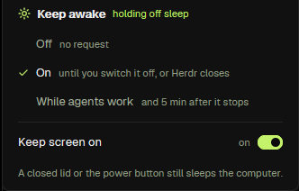

# Keep awake

A sun in Herdr's tab bar that keeps this computer from going to sleep on its idle timer: off, on until switched off or
Herdr closes, or while any agent anywhere is working or blocked. A tiny helper process holds the request, so nothing
about the power plan, the registry or the display is changed, and no administrator right is needed.

## What you see

- **In the tab bar**, beside `Panel` and `Jig`, a 26 px sun. Off it is dim; while the request is held it takes the accent
  colour and a selected background. Its tooltip names the mode and whether the computer will sleep, and says a right click
  opens the modes.
- **The popup** (330×252, at the pointer): `Keep awake` and `holding off sleep` or `not holding`, then three rows — `Off`,
  `On` ("until you switch it off, or Herdr closes"), `While agents work` ("and 5 min after it stops") — the current one
  ticked; a `Keep screen on` row with a 28×16 switch and `on`/`off` beside it; and a line saying a closed lid or the power
  button still sleeps the computer.
- Nothing else: the worker has no panel of its own. In the layout it sits in a 0 px block of the sidebar, unseen.

## How it behaves

- **A left click** on the sun turns `On` when the mode is `Off`, and `Off` for either working mode (the brief's Off ↔ On).
  **A right click** opens the popup; picking a row sets that mode and closes it. `Ctrl+Shift+Alt+K` cycles Off → On →
  While agents work → Off through `keep-awake.cycle`.
- **Off** holds no request. **On** holds it until the mode changes or Herdr exits. **While agents work** holds it while any
  agent in any space, tab or machine is `working` or `blocked`, and for `idleMinutes` (5 by default) after the last one
  stops, so a status flicker or a quick hand-over never stops and starts the helper.
- **The screen is kept on too** by default (`display: true`). The popup's switch writes `config.json` and, when the mode is
  holding, restarts the helper at once with the new flag (stop, then start: never two), so the screen follows without waiting
  for the helper to die. The sun's tooltip says whether the screen is kept on. A closed lid or the power button still sleeps
  the computer.
- **One helper only.** Its PID lives in `shared("keep-awake.helper")` and a fresh claim in `keep-awake.helper.json` (the app
  folder) lets only one worker start one, so two windows cannot each start their own. A second copy, a reload or a restart
  reuses it while it is alive and its command line is ours on that platform, with the same Herdr as owner.
- **Never an unverified kill.** Before every `taskkill`/`kill` the PID is checked: alive, and its command line is this mod's
  helper for this owner. A record that is gone, unreadable or now another process's is dropped without touching it, and a
  failed liveness check never becomes a kill.
- **It ends with Herdr.** The helper checks its stop file and Herdr's process every 5 seconds; on close the mod writes
  `stop` and returns (no process checks), so it is gone within about 5 seconds. Every command the worker runs has a deadline;
  a step that never returns clears its flag and is retried, and a release whose liveness check failed keeps the record. Its OS request is tied to its own process, so a crash cannot
  leave the computer awake for ever.
- **Failures** (no Herdr process found, a helper that would not start) post one warning notification and leave the mode as
  it was.

## Built from

- `main.js`: the worker (`init`, a 1 s timer, `nextCommand()` for `cycle`/`on`/`off`/`agents`, `close`) and the popup
  (`{ menu: true }`). It reads `agents()`, `window().platform`, `appHome()`, `shared("keep-awake.mode")`, writes
  `shared("keep-awake.active")` and `shared("keep-awake.helper")`, reads and writes `keep-awake.stop` in the app folder,
  and runs `exec` on Herdr's own computer (never on a space's) for the helper, `appPidCommand`, `aliveCommand`,
  `commandLineCommand` and `stopCommand`.
- `lib.js`: the pure parts — `modeOf`, `toggleMode`, `nextMode`, `tooltip`, `anyBusy`, `decide` (the idle timer),
  `parseConfig`, `setDisplay` (the switch's write, keeping the file's other fields), `parsePid`, `isHelper`, `helperAction`,
  and the commands for each platform:
  - **Windows:** `powershell -NoProfile -Command "$q = @(…quoted words…) -join ' '; $p = Start-Process -FilePath
    'powershell.exe' -ArgumentList $q -WindowStyle Hidden -PassThru; $p.Id"`, which returns at once and prints the hidden
    process's PID. Each argument is quoted for the child command line, so a folder with spaces works. It runs
    `keep-awake.ps1`, which calls `SetThreadExecutionState(ES_CONTINUOUS | ES_SYSTEM_REQUIRED [| ES_DISPLAY_REQUIRED])`,
    repeats it every 5 s, and exits if its owner PID is gone or is no longer `herdr-app` (a reused PID), or if the stop
    file says `stop` for its own token.
  - **macOS:** `caffeinate -i [-d] -w <herdr pid>` in the background (`sh -c 'nohup … & echo $!'`).
  - **Linux:** `systemd-inhibit --what=sleep[:idle] --why="Herdr keep awake" --mode=block sh -c 'while kill -0 <herdr pid>;
    do sleep 20; done' keep-awake` the same way: it watches Herdr itself, and its command line carries the marker and owner
    the mod matches.
- `keep-awake.ps1`: the Windows helper. It exits on the stop file (`stop`), when the owner PID is gone, or when killed, and
  clears the request on the way out.
- `keep-awake.svg`: the sun, a one-colour glyph drawn in the text colour.
- `config.json`: `{ "idleMinutes": 5, "display": true }`, read at start and every minute (a file edit restarts a running
  helper too); the popup writes it back.
- **herdr functions used:** `agents`, `appHome`, `closeOverlay`, `exec`, `nextCommand`, `notify`, `props`, `readTextFile`,
  `setShared`, `shared`, `theme`, `window`, `writeTextFile`. The tab bar (`jig-tabs`) only writes
  `shared("keep-awake.mode")` and opens the popup; every layout reaches the same worker through that shared state.

## Watch out

- **Only Windows was tried on a real computer** here. macOS and Linux build the right command (tested), but caffeinate and
  systemd-inhibit were not run: try them on those systems.
- **A lid or the power button still sleeps the computer.** No software can prevent that without changing the power plan,
  and this mod changes no setting.
- **`powercfg /requests` needs an elevated prompt** to show the request; without it the tool refuses, which is not a sign
  that nothing is held.
- **Herdr's own PID is found by process name** (`herdr-app`); with two windows of two installs, the first is watched.
- **A helper started while no Herdr process is found is not started at all** (one warning), rather than a request no
  process would ever end.
- **The stop file is `keep-awake.stop` in the app folder**, one file whose content names the start that wrote it
  (`run <token>` / `stop <token>`), so a "stop" left by an earlier helper can never end a new one and nothing accumulates; a
  helper restarted by hand must use the same script path, owner and token or the mod will not recognise it.
- **The switch writes inside the app folder** (`mods/keep-awake/config.json`) with `writeTextFile`; a read-only folder or a
  file changed under it shows "Could not write config.json" and leaves the setting as it was.
- **The tab bar is `jig-tabs`**, which this repository owns; the popup is `openOverlay({ mod: "keep-awake", kind: "popup",
  props: { menu: true } })`.

## Done when

- `herdr-app check mods/keep-awake` passes, and the sun appears in the tab bar of the `jig` layout, dim.
- Turning it On shows a lit sun, exactly one hidden `powershell.exe` whose command line runs `keep-awake.ps1` with Herdr's
  PID, and `shared("keep-awake.active")` becomes `true`; Off ends that process and clears both values.
- Reloading the mod reuses the same PID; killing the helper makes the mod start one new helper within ~10 seconds.
- With a terminal reporting `working` (an agent), While agents work holds the request, and `idleMinutes` after the last
  agent stops it releases it — `active` goes `false` and the helper is gone.
- The helper exits when its owner process does, and when the stop file says `stop`.
- `herdr/test` passes, and `npm run check` and `npm test` pass.
