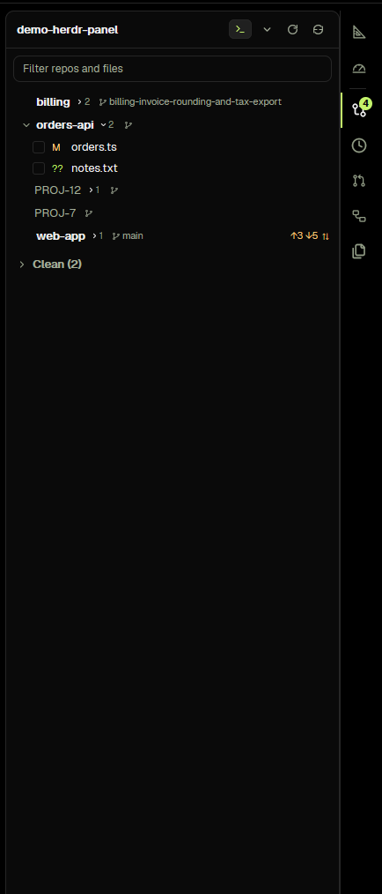

# Changes

A source-control panel for the terminal you are in: it lists every git checkout under the focused terminal's folder, with
who is ahead or behind on origin, the last commit and every changed file, and it stages, commits, fetches, pulls and pushes
without leaving the window. 

## What you see

- **The header**, one row: the folder's name (its full path on hover), a toggle that says `Terminal` or `Space`, a fold-all
  chevron (fold or unfold every repo), how many checkouts were found and how many have changes, a fetch-everything icon and a
  refresh icon.
- **The filter box** under it, a single line matching a checkout's name or a file's path.
- **A checkout's row**, 26 pixels high and one line: a chevron (on a main checkout with worktrees: fold/unfold them; on the
  others: show/hide files), the name in semibold (a worktree indented 16 pixels, its repo prefix dropped: `jig-dark` → `dark`;
  when its folder is the repo's name again it takes the parent folder, `worktrees/PROJ-42/orders-api` → `PROJ-42`; a parent tag
  only for two visible rows that really clash), then a small file chevron and count when it has changes, its branch in a chip
  (the name keeps its natural width, capped at about 60% of the row and truncated only as the last resort; the branch chip
  fills the rest, so it is cut only when it does not fit, from the left, keeping its end; the `feature/` prefix is dim on wide
  panels and dropped on narrow ones; `develop` stays whole; when the branch's last part is the name already shown, the chip is
  only its icon with the branch in the tooltip); the commits-over-base chip on wide panels, `↑2 ↓1` against its upstream. The
  row's action buttons appear at the right on hover only – idle there is no slot, so the branch keeps that room. The folded
  worktree count and a warning dot sit beside a folded repo's name; the only changed-file count is the one beside the file
  fold, hidden under 340 px (a row click still shows the files). The last commit (`e879655 · feat(api): add a client · 1m ago`) is a second line
  only under the focused checkout (and under every row with `rowDetail: "full"`); elsewhere it is in the row's tooltip.
- **Its files** (folded until the row is clicked), 24 pixels each: a checkbox (ticked when staged, `–` when part of it is),
  the status letter, the path with its folders dimmed, and on hover a `↺` to discard that file.
- **The commit box** under the files when something is staged: a message field, `Commit 3` and `Commit & Push`.
- **A clean group** at the bottom, `Clean (3)`, folded until clicked.
- **A result line** under a checkout for 12 seconds after an action: green for done, red for a refusal or git's error.
- Colours come from the theme: added files green (`ansi2`), deleted and conflicted red (`ansi1`), renamed magenta
  (`ansi5`), modified amber (`blocked`). Nothing is drawn in a fixed colour.

## How it behaves

- **Follow the terminal** is the default. The panel lists the focused terminal's current folder, so `cd`ing a tab switches
  it at the next refresh, within 5 seconds, and the filter text stays. The toggle switches this space to its own folder
  instead (`Space`), and the choice is kept per space in the mod's `localStorage`.
- **Inside a git checkout** it shows that checkout, plus its linked worktrees when it is the main checkout. **Outside one**
  it scans for folders with a `.git` up to three levels down (skipping `node_modules`) and includes the linked worktrees
  of each main checkout it finds.
- **Worktrees nest** under their main checkout: a worktree with its own branch, ahead/behind, last commit and files. A
  worktree whose main checkout is not in the list stands on its own.
- **The row buttons** appear when there is something to pull (`↓`) or push (`↑`), and on hover: fetch (`⟳`), pull, push,
  and a terminal icon to open one in the checkout. **Publish** replaces push when git has no same-named destination: no
  upstream, a gone one, or an upstream under another branch's name (a feature branch tracking `main`, say). Publish goes to
  the remote git itself would push to (`pushRemote`, else `remote.pushDefault`, else the configured remote), never onto
  another branch. A branch both ahead and behind shows `diverged — ↑N ↓M: rebase or merge in a terminal` — there is no
  Sync, because a fast-forward pull always fails there. The button follows the same `pushTarget` decision as the dialog
  (cached for half a minute), so its label matches. A tooltip names each one and what it does.
- **Locks**: one per checkout, shared by the panel and its dialog, carrying a token. Fetch every checkout awaits and takes
  each lock (skipping the held ones) and releases only its own token; the panel releases what it holds when it goes away; a
  null or foreign token releases nothing. The dialog keeps its lock until git ends even if Escape closes it, and its release
  happens in the command's task.
- **Push and publish ask first**: a dialog with the branch, the destination git will really use (from
  `pushRemote`, `remote.pushDefault` and `push.default`), why it is a publish rather than a push, the commits to send (at
  most ten, each short hash and subject, then "and 3 more") and Cancel / Push. Nothing is sent until the button is pressed.
  The row's Push/Publish label is neutral until the target is read, and the target cache is dropped after a fetch, push or
  publish on that checkout.
  While it runs the row says `Pushing…` with a spinner, and that checkout's buttons are out of reach in the panel and in
  its dialog; a result shows under the checkout.
- **The commit box** counts the staged files on the button and is disabled without a message. Enter commits, Ctrl+Enter
  commits from anywhere in the box, and `Commit & Push` commits and then opens the push confirm.
- **A click** on a file opens it in a Review tab (another mod, `repo-review`, if installed); on a row with no changed file
  it opens that branch's review. The branch chip opens the branch picker.
- **Empty states say what to do**: `Not a git repository here — cd into one, or list the space's folder.` with a
  `Use Space folder` button, `No git repository under this folder — …`, and `No checkout or file matches.` for a filter.

## Built from

- `main.js`: the panel. `pickRoot` chooses the folder (focused terminal, else the space's, else its first terminal);
  `locate()` adopts a changed folder without clearing the rows until the new ones arrive; a 1-second timer starts a 5-second
  refresh and an immediate one when the folder, a terminal's state or the layout visibility changes. It renders the header,
  filter, rows and commit box, and calls the actions below.
- `lib.js`: no Herdr imports, so tests can load it. `SCRIPT` is one `sh -c` run per refresh: for each checkout it prints
  `@@repo`, `@@git` (common and own git dir), `@@remote origin` when that remote exists, `@@head` (short hash, subject,
  commit time) and `git status --porcelain=v1 -b --no-renames`, capped at 200 files, plus `@@base` for the closest base
  branch. Parsing (`parseRepos`, `parseBranch`, `parseFile`), grouping (`groupRepos`, `isClean`, `aheadChip`), the root
  choice (`pickRoot`), `panesOn`, `ago`, `parseConfig`, and the git actions:
  `stageFile`, `unstageFile`, `stageAll`, `unstageAll`, `discardFile`, `commit`, `switchBranch`, `newBranch`, `listBranches`,
  `pushTarget` (git's real destination: `pushRemote`, `remote.pushDefault`, `push.default`, a gone upstream),
  `fetchRemote`, `pullFastForward`, `pushBranch`, `publishBranch`, `commitsToPush`, and the shared lock
  helpers (`RUNNING_KEY`, `runningKey`, `liveLocks`, `lockOf`, `withLock`, `withoutLock`, `canRun`, `needsPublish`,
  `commitRowStacked`). Each action takes `exec(cmd, args, { cwd, env?, timeout? })` and returns `{ ok, message }`; network
  ones pass `NETWORK_ENV` (`GIT_TERMINAL_PROMPT=0`) and `NETWORK_TIMEOUT` (60 s), and the `sh` wrapper adds
  `GIT_SSH_COMMAND="ssh -o BatchMode=yes"` only when neither the machine's environment nor the repository's
  `core.sshCommand` sets one.
- `push.js`: `PushConfirm`, the dialog, drawn from props `push` (`on`, `path`, `name`, `branch`, `remote`, `target`,
  `targetBranch`, `mode`, `reason`, `base`, `commits`, `count`, `more`, `others`, `timeout`, `what`, `expect`). It takes the
  shared lock, re-checks the refusals, and passes `expect` (the branch and destination it showed) so the action refuses when
  git has moved on.
- `picker.js`: `BranchPicker`, the branch popup (openOverlay with props `picker`), and the shared key
  `repo-changes.done` (`DONE`) that tells the panel a switch or a push happened.
- `layout.js`: `shown(root, mod)`, whether the panel's block is on screen, so it does not poll while hidden.
- `config.json`: `{ "newBranchPrefix": "feature/", "baseBranch": null, "remote": "origin", "networkTimeoutSeconds": 60,
  "rowDetail": "compact" }` (`"full"` shows a commit line under every row).
- **herdr functions used:** `spaces`, `panes`, `focused`, `terminals`, `exec`, `run`, `theme`, `layout`, `shared`,
  `setShared`, `openOverlay`, `props`, `appHome`, `readTextFile`. **Commands:** `tab.new`, `tab.select`,
  `layout.select`/`layout.show`/`layout.hide` (through other mods). **Programs:** `sh` and `git` on the machine the folder
  is on (`exec` with `on`). **herdr data:** `spaces()[].folder`/`machine`/`tabs`, `panes()[].cwd`/`terminal`/`status`,
  `focused().pane`/`terminal`/`cwd`.
- **Icons:** `push.svg`, `pull.svg`, `fetch.svg`, `refresh.svg` in this folder, drawn in the theme's text
  colour; branch, chevron, check, plus, minus and terminal glyphs come from Herdr's `workspace-chrome` mod.
- **Shared state:** `shared("badge.repo-changes")` = `{ count, tone }`, the number of checkouts with changes, for an
  activity bar that wants it; `shared("repo-changes.done")` = `{ path, message, at }` after a switch or a push.

## Watch out

- **A POSIX shell** is assumed on the machine that holds the folders: the scan and every network command run through
  `sh -c` (the network ones so they can set `GIT_TERMINAL_PROMPT` and use `timeout`; Herdr's `exec` has no `env` option).
  On a machine without `sh` the panel cannot read checkouts at all.
- **git 2.31 or newer** for `rev-parse --path-format=absolute` in the scan; without it the `@@git` line is empty and
  worktrees do not nest.
- **Herdr's `exec` stops at 30 seconds**, so the 60-second `timeout` in `config.json` is often the second line of defence:
  the dialog and the panel turn a stopped command into "took too long and was stopped". Do not promise a longer wait than
  the app allows. Without `timeout` (macOS), the wrapper's own `sleep`/`kill` watchdog exits 124 the same way.
- **A push's destination is git's, not the branch's**: `branch.<b>.pushRemote` and `remote.pushDefault` can send it to
  another remote, and the panel shows that remote's branch and names it in full. `push.default=matching` has no single
  destination, so the panel offers Publish instead of sending several branches.
- **The commit list is a snapshot**: it is read when the dialog opens, so a commit made in a terminal between opening and
  pressing Push is not listed, though `git push` sends it. The counts are re-checked by the action.
- **A publish lists the branch's commits over `origin/HEAD`**, not every object git will send; a new branch cut from an old
  base shows its own work, which is what the person wants to see.
- **One action at a time**: while one runs, every row's buttons are disabled, not just that row's.
- **The row is tight at 300 px**: the commits-over-base chip is hidden under 480 px and the summary under 380 px, the
  branch chip is clipped, and the commit message's placeholder is cut. The full paths are always in the tooltips.
- **The base branch** is a heuristic (the candidate with the fewest commits over HEAD); a branch that should be measured
  against something else has no setting for it yet.

## Done when

- `herdr-app check <this folder>` passes.
- With a terminal in a folder that holds two repositories, the panel lists both; `cd`ing into one lists only that one and
  its worktrees within 5 seconds, with the filter text still in the box.
- The toggle switches to the space's folder and back, and the choice survives a panel reload.
- The push icon on a branch with one unpushed commit opens the dialog with that commit's hash and subject; Cancel sends
  nothing; Push sends it and `git status -sb` in a terminal shows the branch no longer ahead.
- Publish on a new branch sets its upstream (`git rev-parse --abbrev-ref @{upstream}` says `origin/<branch>`).
- Pull on a branch behind origin fast-forwards it; on a diverged branch it refuses with git's message and the history is
  unchanged.
- Push with nothing ahead is refused; a fetch moves `origin/main` without touching the working tree.
- With an agent working in a checkout, push, pull and publish are refused before any git command runs.
